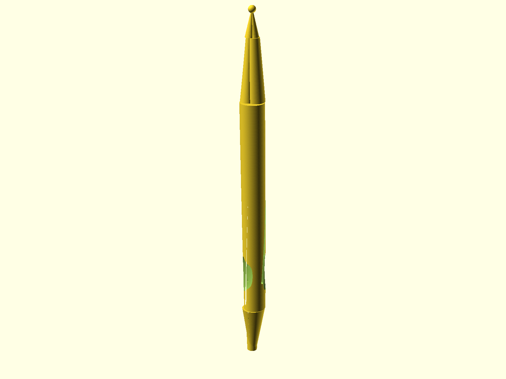
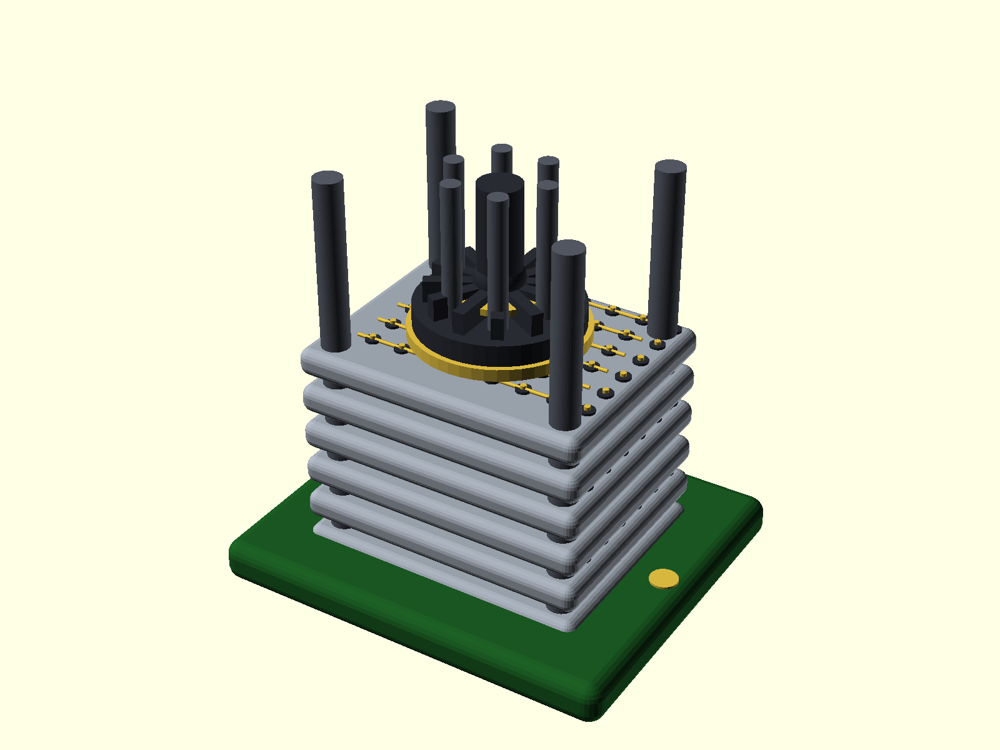
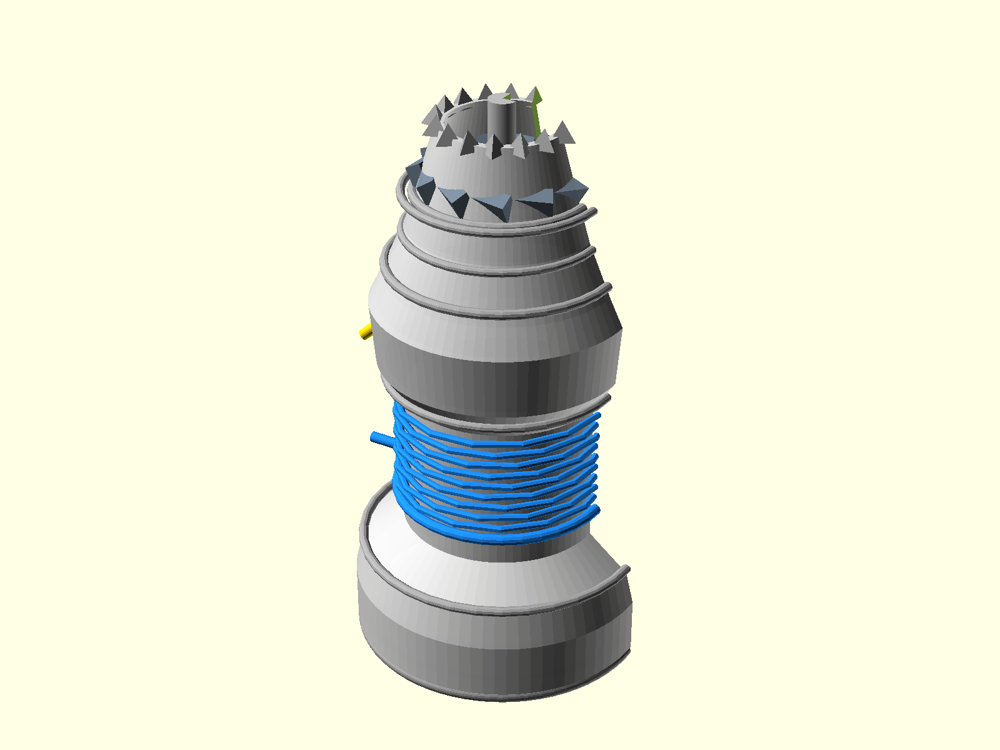
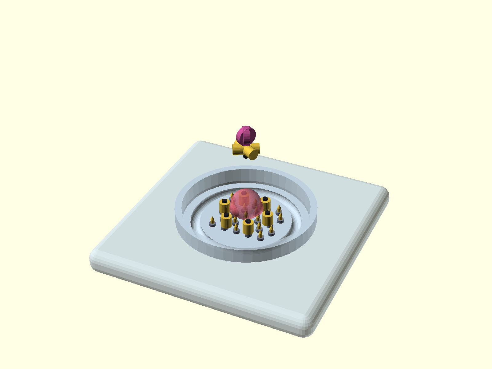
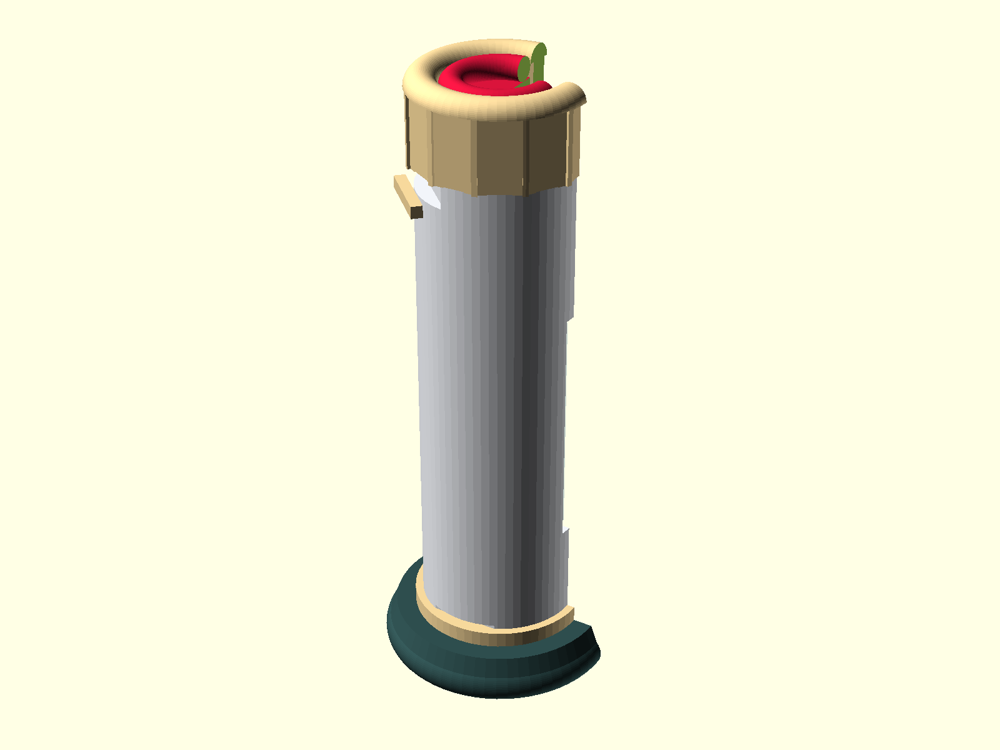
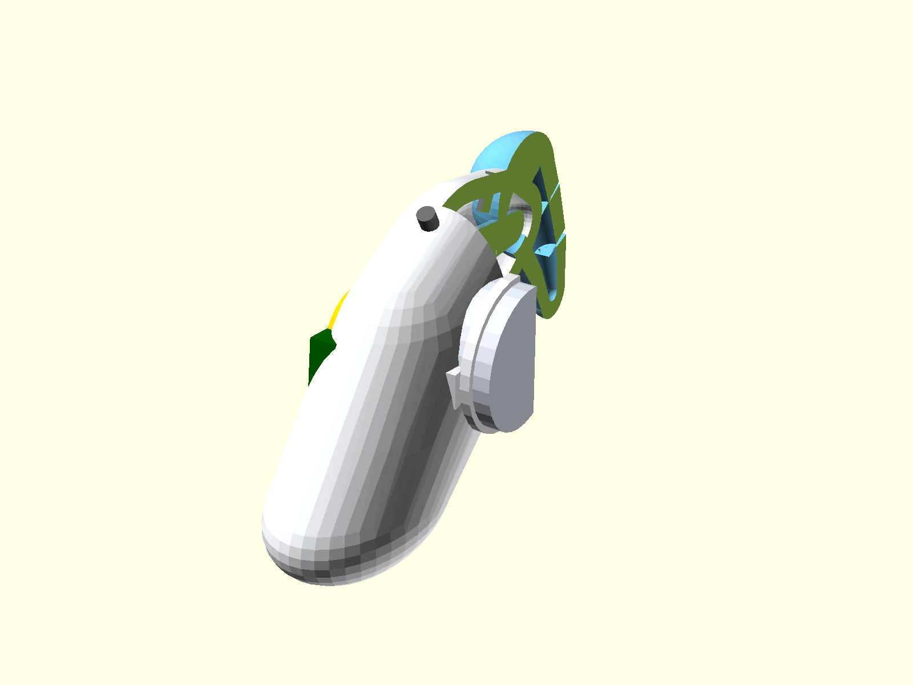

# Personal CAD Portfolio

**Parametric, code-driven mechanical design.** Every model in this repository is written
from scratch in **OpenSCAD** — there are no imported meshes and no GUI-history files. Each
part is defined as a re-evaluable, fully parametric CSG program, so a single constant edit
propagates through the entire geometry. The set spans four application domains: **aerospace
propulsion, neuromorphic hardware, microphysiological systems, and medical/wearable devices.**

| | |
|---|---|
| **Toolchain** | OpenSCAD (parametric CSG), rendered Offscreen |
| **Method** | Feature-by-feature modules, top-level `difference()` cutaways, C1-smooth lofting |
| **Units** | Millimetres (`$fn`-controlled facet budget per subsystem) |
| **License** | MIT — see [`LICENSE`](LICENSE) |

> **Rendering the gallery yourself:** every image below is reproducible with
> `openscad -o images/<name>.png --projection=p --viewall --autocenter <project>.scad`.
> `F5` is fast preview; `F6` is the final CGAL/manifold boolean pass.

**Contents** — [01 Aerodynamic Pen](#01--aerodynamic-pen-body) · [02 Neuro Crossbar](#02--neuromorphic-crossbar-array) · [03 Hydrogen Turbofan](#03--hydrogen-fuelled-turbofan-engine) · [04 Neuralwell Organoid](#04--neuralwell-organoid-on-chip) · [05 Pediatric Injector](#05--pediatric-low-pain-injector) · [06 Sensory Gating Earpiece](#06--sensory-gating-earpiece)

______________________________________________________________________

## 01 · Aerodynamic Pen Body

*Low-drag, boundary-layer-controlled writing instrument — a polar airfoil extruded with
spanwise twist.*

<table>
<tr>
<td width="60%" valign="top">

**How it works**

The cross-section is a parametric **polar laminar teardrop**,
`r(θ) = Rmax · [ floor + (1 − floor)·|cos(θ/2)|^n ]`, with `n = 0.78` and a blunt-tail
floor of `0.45` — maximum thickness at the rounded `θ = 0°` nose, a Kamm-style blunted
trailing edge at `θ = 180°`. The long axis is built as a chain of `linear_extrude()`
sections carrying a cumulative **120° helical twist** (`twist_per_mm`) and per-station scale,
so the profile rotates and tapers smoothly from the writing tip (`scale 0.32`) to a solid
aero end-cap spike (`scale → 0.02`).

Every secondary feature is projected onto the *true twisted shell* through one mapping,
`surface_point(φ, z) = [r·cos(φ + kz), r·sin(φ + kz), z]`:

- three **finger-contour pockets** at 120° spacing, each a tri-axial ellipsoid seated on the
  shell so the boolean cut leaves a smooth concave saddle;
- four **helical micro-flutes** hulled from overlapping spheres that track the rotating
  surface — print-friendly riblet-like boundary-layer grooves;
- a stepped internal bore that necks the standard 4.2 mm cartridge down to a 2.3 mm
  writing aperture.

**Where it matters**

Directly mirrors **riblet / shark-skin drag-reduction** surfaces, **boundary-layer
micro-fluting**, and **ergonomic design for additive manufacturing**. The polar-profile +
twist-extrude idiom is the same math used for **turbomachinery blades**, **propeller
sections**, and **laminar-flow fairings**.

**Limitations**

A concept model, not a CFD-validated part. The 0.9 mm flutes approximate riblets that must in
reality sit at tens-of-microns scale and be flow-aligned, so the "drag reduction" is
illustrative. Twist+scale extrusions are geometric approximations of a true swept surface, and
there is no modelled refill retention, cap, or thread.

</td>
<td width="40%" valign="top">



<sub>`projects/Aero-pen/aerodynamic_pen.scad` — 145 mm body, Ø12 mm, 120° twist</sub>

</td>
</tr>
</table>

______________________________________________________________________

## 02 · Neuromorphic Crossbar Array

*Stacked 2-D crossbar switching planes with vertical interconnect, modelled as a 3-D compute
stack.*

<table>
<tr>
<td width="60%" valign="top">

**How it works**

A tray-mounted package holding **6 offset crossbar planes** (`8 × 6` cells, 6.0 mm pitch).
Each plane is a thin **PCB-style dielectric sheet** through which two orthogonal buses pass:
row and column **gold wire tracks** are placed at alternating heights (`line_rise`, `wire_gap`)
on odd/even layers so they interleave without shorting — the physical crossbar topology. At
every intersection a **synapse cell** posts a memristor-like junction between the buses.

Vertical **through-silicon-via (TSV) clusters** (6 vias on a 9.0 mm ring) carry signals
through the entire stack, **steel guide posts** with per-plane collars register the sheets, a
central **axon column** is wrapped by **myelin-like insulating rings** in each inter-plane gap,
and a finned **cortex cap** closes the stack. The PCB tray carries edge connectors and
mounting bosses.

**Where it matters**

A physical read of **memristor / RRAM crossbar arrays** used for **analog in-memory computing**
and **matrix–vector multiplication** at the core of **neuromorphic accelerators** — plus **3-D
heterogeneous integration** (TSVs, interposers) and the neuron/axon/myelin metaphor that maps
biology onto hardware topology.

**Limitations**

Geometric and conceptual: there is no electrical model, no device physics, and no parasitic or
IR-drop analysis. Cell pitch and TSV aspect ratios are not manufacturable at true neuromorphic
density, and the myelin rings are representational rather than functional insulation.

</td>
<td width="40%" valign="top">



<sub>`projects/Crossbar/neuro_crossbar.scad` — 6 planes, 8×6 cells, 6-via TSV cluster</sub>

</td>
</tr>
</table>

______________________________________________________________________

## 03 · Hydrogen-Fuelled Turbofan Engine

*Parametric two-spool turbofan concept running on liquid hydrogen, with a variable-geometry
stealth nozzle and a 90° diagnostic cutaway.*

<table>
<tr>
<td width="60%" valign="top">

**How it works**

The engine axis runs along **+Z (200 mm)** and the outer nacelle is **lofted from a
station/radius contour table** (`outer_contour`) — the classic fan-hump → squeezed-core →
combustor-bulge → nozzle-taper silhouette — constructed as a hollow shell of `SHELL_T = 3 mm`
walls between consecutive samples.

- **Fan stage (0–36):** torus intake lip, rounded **ogive spinner**, 18 twisted/raked rotor
  blades with modelled tip clearance, splitter, and outlet guide vanes.
- **Compressor stage (36–104):** HP drum spool, **4 rotor rows** (20 blades, `twist = −30°`)
  with counter-staggered stators, and an **LH₂ cryogenic cooling jacket** — a 9-turn helix of
  hulled tubes wrapped around the casing with header rings and a feed stub.
- **Combustor (104–146):** dome, **micro-swirl injector manifold** (12 radial ports staggered
  4° off-radial), and a **perforated liner** (4 rows × 8 dilution holes) with a spark igniter.
- **Exhaust (146–200):** turbine shroud rings, NGV + **HP turbine** (`twist = −58°`), exhaust
  centre plug, and a **variable-geometry stealth nozzle** — 12 overlapping petals swung through
  `nozzle_open = 26°`, plus 16 sawtooth **chevrons**.

Blade sections come from a shared **biconvex airfoil** function
`y = 2t·√(u(1−u))`, extruded with spanwise twist and axial rake.

**Where it matters**

Real **Brayton-cycle turbofan architecture**, **hydrogen aviation** (cryogenic LH₂ as a
heat-sink), **variable-area nozzle / thrust vectoring**, **low-observable (stealth) exhaust
chevrons** for radar-signature control, and **turbomachinery blade design** (stagger, rake,
twist, tip clearance).

**Limitations**

Concept geometry only — no thermodynamic cycle solve, no CFD, no structural or thermal-stress
analysis. Blade counts and station positions are representative rather than optimised; the LH₂
jacket is schematic with no flow model; nozzle petals rotate rigidly rather than articulating
as a real linkage.

</td>
<td width="40%" valign="top">



<sub>`projects/hydroengine/hydroengine.scad` — 200 mm axis, Ø90 mm fan, 90° cutaway</sub>

</td>
</tr>
</table>

______________________________________________________________________

## 04 · Neuralwell Organoid-on-Chip

*A microfluidic culture well for 3-D neural organoids, with a hexagonal micro-electrode
array and integrated perfusion.*

<table>
<tr>
<td width="60%" valign="top">

**How it works**

A **66 mm glass culture plate** carries a Ø19.5 mm raised well floor. Inside it, a
**hexagonally close-packed (HCP) pillar array** is generated by lattice projection — pillars
sit at `3.6 mm` pitch (odd rows offset by half a pitch) and are clipped by `sqrt(x²+y²) ≤ 11 mm`.
Each pillar is an **insulated base pad** (PDMS) topped by a **gold micro-electrode** with a
filed tip, giving a multi-electrode array (MEA) under the tissue bed.

A **perfusion moat** is turned as a revolved half-torus groove; **two fluidic ports** angle in
from the rim for media in/out; **edge contact leads** fan out to buried pads; an optional
**glass lid** closes the chamber. A translucent **organoid blob** (union of spheres) stands in
for the cultured tissue.

**Where it matters**

**Organ-on-a-chip / microphysiological systems**, **MEA electrophysiology** for recording
neural activity, **3-D cell culture**, and **high-throughput drug screening / neurotoxicity
testing** — the hardware layer beneath in-vitro neuroscience.

**Limitations**

A schematic device render: no fluid-dynamics or perfusion modelling, and electrode count and
pitch are representative rather than routed. Biocompatibility, surface treatment, and
sterilisation are out of scope, and the organoid is a stylised solid, not a biological model.

</td>
<td width="40%" valign="top">



<sub>`projects/organiod/neuralwell_organoid.scad` — Ø19.5 mm well, HCP 3.6 mm MEA</sub>

</td>
</tr>
</table>

______________________________________________________________________

## 05 · Pediatric Low-Pain Injector

*Ultra-compact pen injector sized for small hands, with a kinetic-impact absorber and a full
cutaway of the drug path.*

<table>
<tr>
<td width="60%" valign="top">

**How it works**

A `Ø20 × 75 mm` hollow shell (2 mm wall) houses a **standard 3 mL glass cartridge**. A
**flexible-rib alignment sleeve** grips the vial through four retention ribs while leaving a
`1.2 mm` annular gap; a **metallic kinetic-absorber coil** (8 turns) wraps that gap to damp
insertion shock. The exposed stack is explicit — glass body, amber **fluid volume**, rubber
**bung**, crimson **plunger rod**, and a pre-compressed **drive spring** (both springs share one
parametric helix function).

Layout is governed by a **documented Z-height table** (fluid 13–38, bung 38–42, rod 40–72,
spring 61.5–65.5, button 70), a **green guide channel** centres the rod with a deliberate
**0.2 mm radial clearance**, and a **Luer-lock hub** with thread ridges and a micro-needle
cannula forms the fluid path. The base is a low-insertion-pressure **rounded footplate**. A
**twist-open bayonet cap** and a side **view window** complete the user interface.

**Where it matters**

**Medical-device / drug-delivery design**, **insulin-pen ergonomics**, **pediatric
human-factors**, and **pain-reduction engineering** (kinetic damping, low insertion pressure).
The hub follows the **Luer-lock** interface convention and the **3 mL cartridge** format.

**Limitations**

No dose-metering or click-counting mechanism, no priming/air-removal path, and the spring
dynamics are not simulated. The Luer thread is stylised (not to ISO gauge), and sterilisation,
packaging, and shelf-life are unmodelled. The cutaway is applied only at the top level for
inspection.

</td>
<td width="40%" valign="top">



<sub>`projects/Painless Injection/pediatric-inject-sys.scad` — Ø20 × 75 mm, 90° cutaway</sub>

</td>
</tr>
</table>

______________________________________________________________________

## 06 · Sensory Gating Earpiece

*Behind-the-ear wearable that filters redundant acoustic stimuli and reads mastoid
bio-signals.*

<table>
<tr>
<td width="60%" valign="top">

**How it works**

The housing is an **organic pod built as the convex hull of a table of scaled ellipsoids**
(`body_sec`) — a sagittal spine of six sections lofted into a smooth, head-hugging shell with
`1.2 mm` walls. Inside sit a **14 × 6 × 1.5 mm micro-PCB**, a **Size-312 button cell**
(`Ø7.9 × 3.6 mm`) behind a **living-hinge access door**, and a **dual-microphone** pair: a
forward port and a rear reference port yawed `±28°` apart to enable **directional acoustic
gating**.

A **tapered acoustic ear hook** (radii `3.4 → 1.6 mm`) with an **open internal lumen** curls
from the crest toward the canal; **translucent tubing** carries sound from the mic manifold to
the hook bore. Two **gold biosensing electrodes** sit on the medial face against the mastoid.

**Where it matters**

**Wearable bioelectronics / hearables**, **auditory neuroscience** — specifically **sensory
gating** and **prepulse inhibition** (the brain's filtering of redundant stimuli, measured as
P50 suppression) — and **non-invasive neurotech** using **mastoid EEG/EMG** electrodes with
**directional beamforming** microphones.

**Limitations**

No electronics, acoustic, or signal-chain model; electrode contact impedance is not
represented and battery life is fictitious. The ear-hook fit is generic rather than derived
from individual anthropometry, and the internals are shown via the top-level cutaway.

</td>
<td width="40%" valign="top">



<sub>`projects/Sensory Gating Earpiece/sensory_gating_earpiece.scad` — 28 × 8 × 12 mm, 90° cutaway</sub>

</td>
</tr>
</table>

______________________________________________________________________

## Repository Layout

```
CAD-portolio/
├── images/                         # rendered PNG gallery (1600 × 1200)
├── projects/
│   ├── Aero-pen/                   # 01  aerodynamic pen body
│   ├── Crossbar/                   # 02  neuromorphic crossbar array
│   ├── hydroengine/                # 03  hydrogen turbofan engine
│   ├── organiod/                   # 04  neuralwell organoid-on-chip
│   ├── Painless Injection/         # 05  pediatric low-pain injector
│   └── Sensory Gating Earpiece/    # 06  behind-the-ear sensory gating pod
├── LICENSE
└── README.md
```

## Rendering

```bash
# single model -> PNG (perspective, auto-framed)
openscad -o images/aero-pen.png \
  --imgsize=1600,1200 --projection=p --viewall --autocenter \
  --camera=0,0,0,68,0,25,0 projects/Aero-pen/aerodynamic_pen.scad
```

Each script exposes feature toggles at the top (e.g. `show_cutaway`, `_ENABLE_BORE`) so
subsystems can be isolated for inspection.

______________________________________________________________________

## License

Released under the **MIT License** © 2026 Akhil Gopu — see [`LICENSE`](LICENSE).
